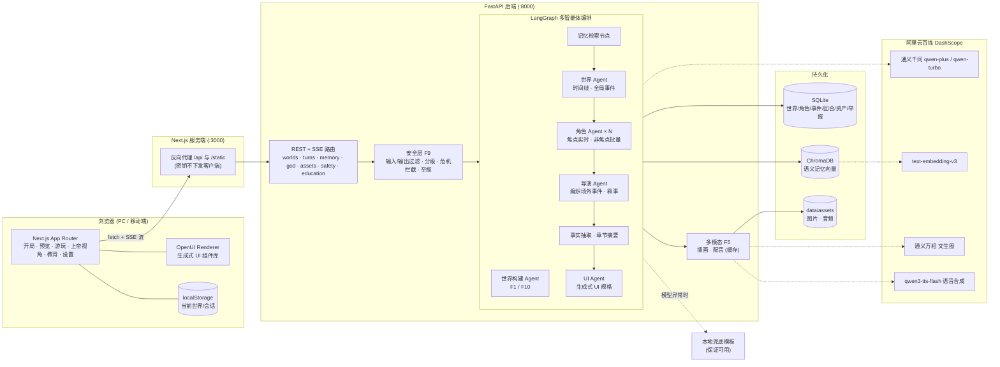

# 《织梦》—— AI 原生互动叙事引擎

> 一句话，生成一个可玩、有记忆、会自己运转的世界。

《织梦》是面向“全国高校 AI Web 开发挑战赛”的作品。它不是“AI 助手 + 问答”，而是以**生成式世界**为核心：
AI 生成的不是一段文字，而是一个包含角色、地点、规则、事件与记忆的可交互世界——剧情、NPC、界面都随玩家行为动态生长。

- 输入“一个民国上海滩的侦探故事，我是报社记者”，几秒内得到带地图、角色、初始冲突的世界；
- NPC 由多智能体驱动，你不在场时他们也在行动，产生“场外大事件”；
- 世界记忆（SQLite 结构化状态 + ChromaDB 向量检索）保证长程一致，能回忆“三章前”的细节并给出出处；
- 关键场景自动生成插画与配音；状态面板、人物关系图、地图等界面由 AI 按剧情动态生成（OpenUI）；
- 上帝视角查看并干预世界；存档/海报/结局短视频分享；双向内容安全；教育模式把课文变成可走进的世界。

## 目录

- [系统架构](#系统架构) · [技术栈](#技术栈) · [功能模块 F1–F10](#功能模块-f1f10)
- [快速开始](#快速开始) · [环境变量](#环境变量) · [测试](#测试) · [演示脚本](#演示脚本) · [团队分工](#团队分工)

## 系统架构



**一回合的数据流（F2）**：玩家输入 → 安全检查 → 检索世界记忆（结构化状态 + 向量） → 世界 Agent 推进时间线 → 角色 Agent 自主行动（产生场外事件）→ 导演 Agent 编织叙事并流式输出 → 抽取新事实写入记忆（每 5 回合一章，自动摘要压缩）→ UI Agent 生成界面 → 关键场景触发插画与配音。
任一步模型失败：不提交本回合（进度不丢），前端可一键重试；无 Key 或连续失败时自动降级到本地兜底模板。

## 技术栈

| 层 | 技术 |
|---|---|
| 前端 | Next.js (App Router) · React · TypeScript · pnpm · OpenUI（`@openuidev/react-lang` 生成式 UI）· lucide-react · html-to-image（海报）· MediaRecorder（结局短视频）· ESLint + Prettier |
| 后端 | Python 3.12 · FastAPI · SSE 流式输出 · LangGraph（导演/世界/角色/UI 多智能体编排）· Pydantic |
| 存储 | SQLite（结构化世界状态）· ChromaDB（语义记忆向量库）· 本地文件（生成资产） |
| 模型 | 阿里云百炼 DashScope：qwen-plus（叙事）、qwen-turbo（快速决策/审核）、text-embedding-v3（向量）、通义万相（插画）、qwen3-tts-flash（配音） |
| 质量 | pytest（API 冒烟，覆盖 AC-1~AC-9）· Playwright（端到端 UI 验收） |

## 功能模块 F1–F10

| 编号 | 模块 | 实现要点 |
|---|---|---|
| F1 | 造化开局（世界生成） | 一句话/上传文本 → 分层提示工程 → 结构化世界 JSON（时代、地点地图、角色、初始冲突、基调）；SSE 展示生成进度；可确认或重生成；失败自动兜底模板 |
| F2 | 互动游玩（叙事推进） | 选项或自由输入；叙事逐字流式渲染；思考可视化；失败可重试且不破坏进度（`client_turn_id` 幂等 + 回合快照重放） |
| F3 | 世界模拟（多智能体 NPC） | 角色 Agent 维护目标/情绪/记忆并输出行动；世界 Agent 推进时间线；导演 Agent 编织场外事件；焦点 NPC 实时、非焦点批量推进以控成本；“场外大事件”面板 |
| F4 | 世界记忆（一致性） | SQLite 结构化状态 + ChromaDB 向量检索；每回合抽取关键事实；每章摘要压缩；“回忆”问答给出出处（第几章第几回合） |
| F5 | 多模态生成 | 关键节点（开场、章节边界、重大/干预事件）自动生成插画 + 配音；按提示哈希缓存；可手动重新生成；失败用 SVG/静音占位 |
| F6 | 生成式 UI | UI Agent 依据剧情生成状态面板、人物关系图、背包、地图、事件流、知识卡等组件规格，前端用 OpenUI 渲染；组件可交互（点击即行动/前往） |
| F7 | 上帝视角与干预 | 查看任意 NPC 的状态、行动轨迹、记忆；插入事件（写入记忆留痕，影响后续叙事）；手动推进一次世界 |
| F8 | 存档与分享 | 自动持久化，刷新可恢复；导出/导入 JSON 存档（跨会话继续）；生成结局海报（含 AI 标识与安全标识）；导出结局短视频 |
| F9 | 安全与合规 | 输入/输出双向过滤（关键词 + 模型审核）、内容分级、未成年人模式、危机内容拦截并给出求助热线、举报入口、全部 AI 内容标注“内容由AI生成” |
| F10 | 文化/教育模式 | 课文/史料/非遗 → 可走进的互动世界；知识卡片随剧情解锁；学习小结（要点、时间线、小测验、反思） |

## 快速开始

### 依赖

- Python 3.12 与 [uv](https://docs.astral.sh/uv/)（或 venv + pip）
- Node.js ≥ 20 与 pnpm 10
- （可选）阿里云百炼 API Key；不配置也能用本地兜底模板完整演示

### 一键启动

```bash
git clone <repo> zhimeng && cd zhimeng
cp .env.example .env          # 填写 DASHSCOPE_API_KEY（可留空）
scripts/dev.sh                # 后端 http://localhost:8000 + 前端 http://localhost:3000
scripts/dev.sh --fallback     # 强制本地兜底模式（离线演示 / 无 Key）
scripts/dev.sh --prod         # 前端使用 next build && next start
scripts/dev.sh --api-only     # 只启动后端（--web-only 只启动前端）
```

`dev.sh` 会：自动从 `.env.example` 生成 `.env`；优先使用当前 shell 中已导出的 `DASHSCOPE_API_KEY`（不会打印密钥）；
首次运行时创建 `backend/.venv` 并安装依赖（`backend/pyproject.toml` 或 `requirements.txt`）、执行 `pnpm install`；
启动前检查后端入口 `backend/app/main.py` 与 `pnpm`/`curl` 是否就绪；同时启动前后端并等待健康检查（超时会给出提示）；Ctrl+C 一并停止。

### 分别启动

```bash
# 后端
cd backend
uv venv .venv --python 3.12 && uv pip install --python .venv/bin/python -e .   # 或 -r requirements.txt
.venv/bin/uvicorn app.main:app --reload --port 8000

# 前端（/api 与 /static 由 Next 代理到 BACKEND_ORIGIN）
cd frontend
pnpm install
pnpm dev            # http://localhost:3000
```

健康检查：`curl http://localhost:8000/api/health` → `{"status":"ok","llm":true|false,...}`，`llm=false` 表示当前为兜底模式。
接口文档见 [API.md](API.md)，FastAPI 自带交互式文档 `http://localhost:8000/docs`。

## 环境变量

| 变量 | 默认 | 说明 |
|---|---|---|
| `DASHSCOPE_API_KEY` | 空 | 阿里云百炼 API Key（[获取](https://bailian.console.aliyun.com/?apiKey=1)）。**只保存在后端环境变量 / `.env`，绝不下发浏览器**。为空 → 兜底模式 |
| `ZM_FORCE_FALLBACK` | `0` | `1` 时完全不调用远程模型（CI / 离线演示） |
| `ZM_DATA_DIR` | `backend/data` | SQLite、ChromaDB、生成资产所在目录 |
| `CHAT_MODEL` / `FAST_MODEL` | `qwen-plus` / `qwen-turbo` | 叙事模型 / 快速决策与审核模型 |
| `EMBEDDING_MODEL` | `text-embedding-v3` | 记忆向量模型 |
| `IMAGE_MODEL` / `TTS_MODEL` | `wanx2.1-t2i-turbo` / `qwen3-tts-flash` | 插画 / 配音模型（旧名 `qwen-tts` 会自动映射，见 BUGS.md BUG-002） |
| `SYNC_LLM_TIMEOUT_S` | `8.0` | 非流式 LLM 调用（学习小结、记忆问答、抽取、测验）总时限，超时用本地兜底（BUG-007） |
| `GUARD_TIMEOUT_S` | `6.0` | 安全审核单次 LLM 调用时限，超时退回关键词/规则层 |
| `AGENT_BUDGET_S` | `2.0` | 回合中叙事前世界/角色 Agent 的时间预算，超时用本地规则，保证首字延迟 |
| `RETRIEVAL_BUDGET_S` | `1.2` | 记忆向量检索时间预算，超时跳过检索 |
| `KEY_SCENE_MEDIA_DEADLINE_S` | `3` | 关键场景插画/配音在回合流中的最长等待（秒）；超时先返回 `pending` 占位，后台原地升级（同 id，`GET /api/assets/{id}?wait=` 可长轮询） |
| `ZM_ADMIN_TOKEN` | 空 | 管理员令牌：`GET /api/reports` 不带 `world_id` 查看全量举报需请求头 `X-Admin-Token` 一致；为空则禁用全量列表 |
| `BACKEND_PORT` / `FRONTEND_PORT` | `8000` / `3000` | dev.sh 使用的端口 |
| `BACKEND_ORIGIN` | `http://localhost:8000` | Next.js 反向代理目标 |
| `ZM_PROXY_TIMEOUT_MS` | `180000` | Next 反向代理超时（毫秒）；Next 16 默认 30s 会让长请求 socket hang up（BUG-007）；修改后需重新 build / 启动前端 |
| `NEXT_PUBLIC_API_BASE` | 空 | 可选：让浏览器直连后端（默认同源代理） |

## 测试

```bash
scripts/qa.sh            # API 冒烟 + E2E，结果写入 docs/qa-report.md
scripts/qa.sh api        # 只跑 API 冒烟 + 包级契约测试（进程内、兜底模式、临时数据目录，无需启动服务）
scripts/qa.sh api-real   # 同上但走真实模型（DASHSCOPE_API_KEY 取自环境或 .env；输出中的密钥自动打码）
scripts/qa.sh e2e        # 只跑 E2E（需应用已运行）
backend/.venv/bin/python scripts/ttft.py --turns 5   # 对运行中的服务测首字延迟 / 世界预览耗时（只输出数字）

# E2E（需先 scripts/dev.sh 启动应用；使用系统 Chrome）
cd tests/e2e && pnpm install
pnpm test                         # AC-1 ~ AC-9
ZM_MODE=real pnpm test            # 真实模型模式（放宽超时；回合被限流失败时像用户一样点「重试」，次数记入测试注解）
pnpm demo                         # 跑附录演示脚本并截图到 docs/screens/（ZM_MODE=real pnpm demo 用真实模型）

# API 冒烟打到运行中的服务（例如真实模型模式）
ZM_API_BASE=http://localhost:8000 backend/.venv/bin/python -m pytest backend/tests/integration -q
```

验收用例与测试的对应关系见 [docs/ACCEPTANCE.md](docs/ACCEPTANCE.md)，已知问题见 [BUGS.md](BUGS.md)。

## 演示脚本

对应 SRS 附录，`tests/e2e/demo.spec.ts` 可自动跑完全程并截图（`docs/screens/`）：

1. **秒级开局**：首页输入“一个民国上海滩的侦探故事，我是报社记者”，点击「造化」，观看生成进度，预览地图、角色、初始冲突后「进入世界」。
2. **游玩三轮**：自由输入或点选项推进三回合；观察叙事流式输出、右侧“场外大事件”面板中 NPC 的自主行动，以及关键场景的插画与配音。
3. **考记忆**：在「回忆」中提问“第一回合我在码头遇到的线人叫什么？”，系统回答并标注出处（第几章·第几回合）。
4. **上帝视角**：切换「上帝视角」，查看每个 NPC 的状态与行动轨迹；插入事件“十六铺码头突发大火”，回到游玩页，下一回合叙事随之改变。
5. **教育模式**：进入「教育模式」，粘贴《桃花源记》片段，生成可走进的世界，查看知识卡片，并生成学习小结与小测验。
6. **安全分级**：输入违规内容（如制作危险物品），被拦截并提示；危机类表达给出求助热线；所有生成内容带“内容由AI生成”标识，可一键举报。
7. **分享**：导出“我的世界”结局海报与结局短视频，并导出 JSON 存档、刷新后恢复进度。

截图：

| 步骤 | 截图 |
|---|---|
| 开局 | `01-home.png` · `02-generating.png` · `03-world-preview.png` · `04-opening.png` |
| 游玩三轮 | `05-play-3-turns.png` |
| 记忆 | `06-memory-recall.png` |
| 上帝视角 | `07-god-view.png` · `08-god-inject.png` |
| 安全 | `09-safety-block.png` |
| 分享 | `10-poster.png` |
| 教育模式 | `11-education-input.png` · `12-education-play.png` · `13-education-summary.png` |

（均位于 `docs/screens/`，由 `pnpm demo` 生成；应用尚未可运行时该目录为空，见 BUGS.md。）

## 实际取舍

plan.md 中部分指标受外部条件（阿里云百炼 / DashScope 的推理时延、限流配额、网络）约束，团队无法单方面保证。我们的做法是：**功能可用、降级合理、体验可接受即视为通过**，并如实记录实测数字与差距（见 `docs/ACCEPTANCE.md`、`docs/qa-report.md`）。

| plan.md 要求 | 问题 | 实际取舍 |
|---|---|---|
| AC-1「5 秒内展示世界设定预览」 | 完整世界（地图+角色+冲突）一次性由大模型生成通常需要数十秒 | 两步生成：快速模型先出骨架预览（目标 ≤5s），大模型后台补全细节并合并（`detail_status`）；兜底模式恒 <1s。真实模型超 5s 只告警不判失败 |
| 流式首字延迟 ≤2s | 回合需先做输入安全审核（LLM）再叙事，实测首字 3.0–4.1s，瓶颈在审核调用 | 审核与检索/Agent 设时间预算并行（`GUARD_TIMEOUT_S`、`AGENT_BUDGET_S`、`RETRIEVAL_BUDGET_S`），超时退回规则层；首字延迟记为备注，持续优化，不作为阻塞问题 |
| 「模型 API 可用」为前置条件 | 同一 Key 多人并发时频繁 429、偶发断流 | 备用模型链自动切换 + 断流续写；全链失败时用本地模板完成回合（`source="fallback"`），用户侧不出现失败 |
| 单次生成失败自动重试 ≥1 次且不丢进度 | — | 服务端重试/切换模型；`client_turn_id` 幂等；失败不提交，可「重试」 |
| 学习小结 / 记忆问答等非流式调用 | 大模型耗时可能 >30s，超过代理默认超时 | 非流式调用 8s 总时限（`SYNC_LLM_TIMEOUT_S`），小结先返回本地版 `status:"pending"`，后台生成完整版；前端代理超时提高到 180s（`ZM_PROXY_TIMEOUT_MS`） |
| AC-10 公网可用、评审账号 | 部署环境不在本轮范围 | 本轮跳过；本地 `scripts/dev.sh --prod` 可完整演示 |
| 测试的时间断言 | 真实模型时延波动 | 兜底模式（确定性）严格断言；真实模型模式下时延只告警 / 记入注解，429、网络错误先单独重跑一次再判定 |

## 团队分工

| 角色 | 负责 |
|---|---|
| 后端工程师 | FastAPI 路由与 SSE、LangGraph 多智能体编排（导演/世界/角色/UI Agent）、世界记忆（SQLite + ChromaDB）、F1–F4、F6–F8、F10 |
| 前端工程师 | Next.js + pnpm、沉浸式叙事界面与设计系统、OpenUI 生成式 UI 组件库、流式渲染、上帝视角/教育/分享页面、响应式 |
| 多模态与安全工程师 | F5 插画与配音（通义万相、qwen3-tts-flash、缓存与占位）、F9 双向内容过滤、分级、未成年人模式、危机拦截、举报 |
| QA / 集成工程师 | 一键启动脚本、API 冒烟与 Playwright E2E（AC-1~AC-9）、回归与缺陷跟踪、README 与演示截图 |

协作约定见 [TEAM.md](TEAM.md)。

## 安全与合规说明

- API 密钥仅存于服务端环境变量，提供 `.env.example` 模板；`.env` 已被 git 忽略。
- 所有 AI 生成内容（叙事、世界设定、插画、配音、海报）标注“内容由AI生成”；分享产物附带内容安全标识与分级。
- 危机类内容（自伤等）优先给出求助热线，不进入剧情生成。

## 许可

本项目为参赛原创作品，仅供学习与评审使用。
