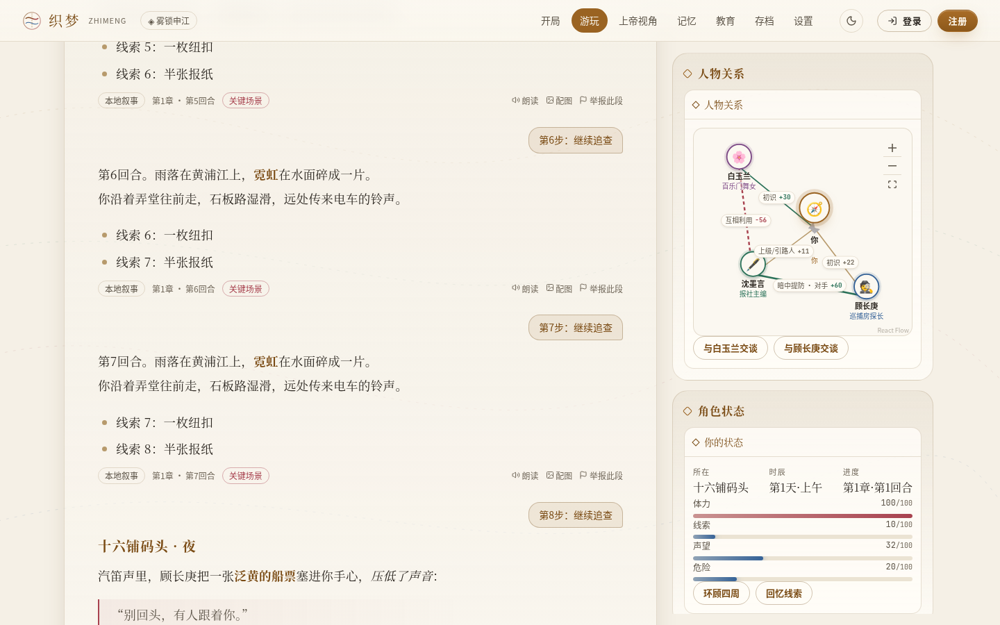
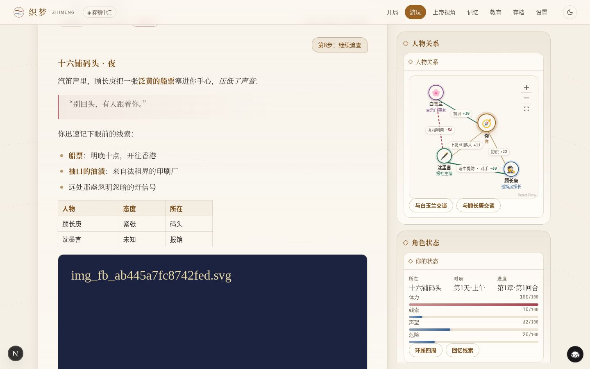
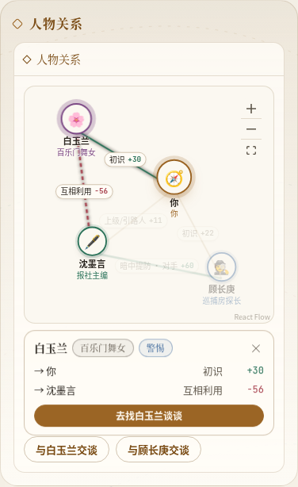
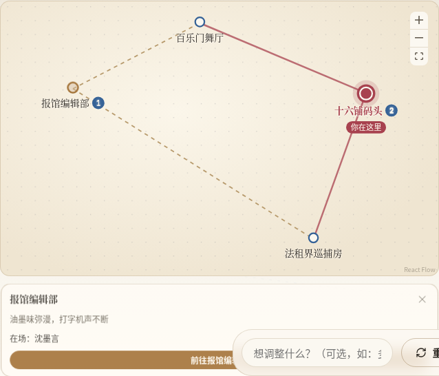
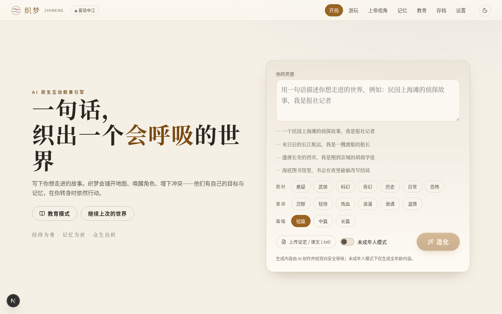
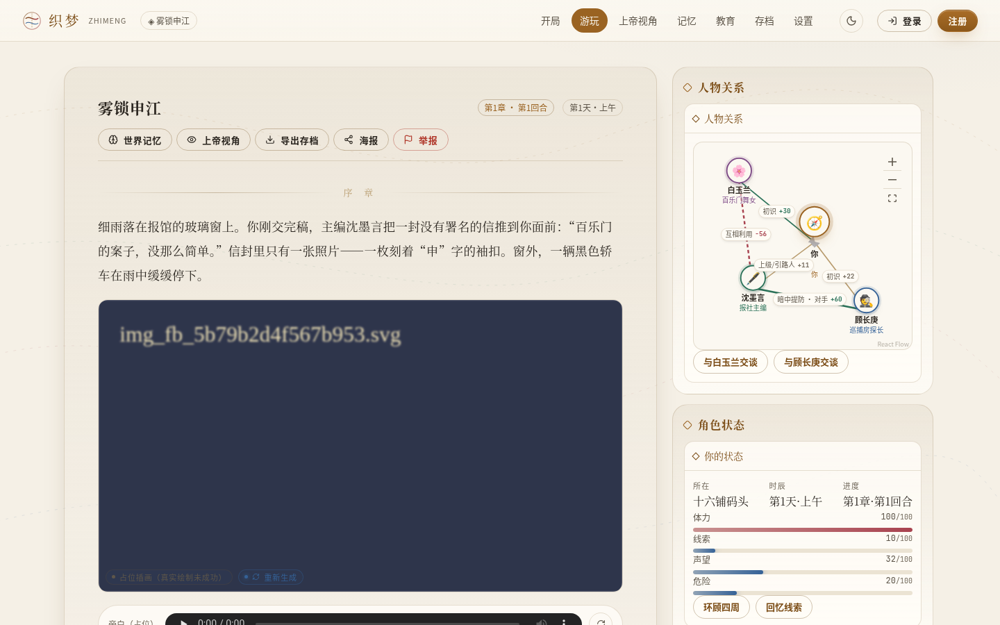
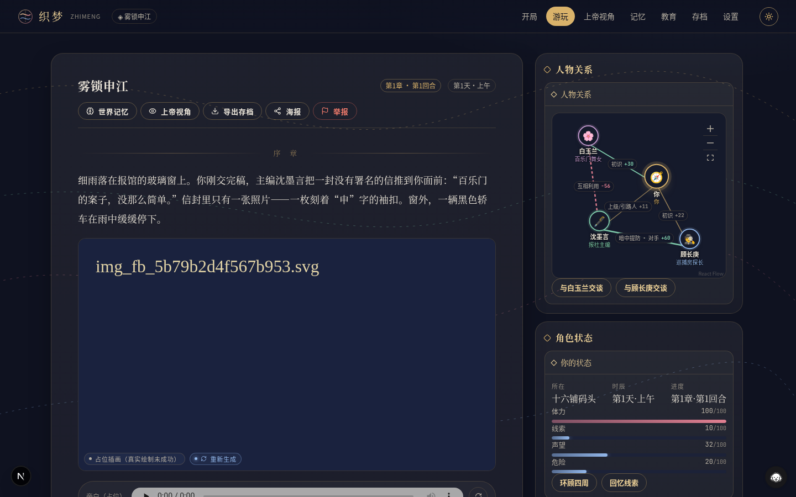

# 《织梦》—— AI 原生互动叙事引擎

> 一句话，生成一个可玩、有记忆、会自己运转的世界。

《织梦》是面向“全国高校 AI Web 开发挑战赛”的作品。它不是“AI 助手 + 问答”，而是以**生成式世界**为核心：
AI 生成的不是一段文字，而是一个包含角色、地点、规则、事件与记忆的可交互世界——剧情、NPC、界面都随玩家行为动态生长。

- 输入“一个民国上海滩的侦探故事，我是报社记者”，几秒内得到带地图、角色、初始冲突的世界；
- NPC 由多智能体驱动，你不在场时他们也在行动，产生“场外大事件”；
- 世界记忆（SQLite 结构化状态 + ChromaDB 向量检索）保证长程一致，能回忆“三章前”的细节并给出出处；
- 关键场景自动生成插画与配音；状态面板、人物关系图、地图等界面由 AI 按剧情动态生成（OpenUI）；
- 上帝视角查看并干预世界；存档/海报/结局短视频分享；双向内容安全；教育模式把课文变成可走进的世界。

## 目录

- [系统架构](#系统架构) · [技术栈](#技术栈) · [功能模块 F1–F10](#功能模块-f1f10)
- [账号与个人中心](#账号与个人中心) · [快速开始](#快速开始) · [环境变量](#环境变量) · [测试](#测试) · [界面说明](#界面说明) · [演示脚本](#演示脚本) · [团队分工](#团队分工)

## 系统架构

```mermaid
flowchart LR
  subgraph Browser["浏览器 (PC / 移动端)"]
    UI["Next.js App Router<br/>开局 · 预览 · 游玩 · 上帝视角 · 教育 · 设置"]
    OUI["OpenUI Renderer<br/>生成式 UI 组件库"]
    LS[("localStorage<br/>当前世界/会话")]
    UI --- OUI
    UI --- LS
  end

  subgraph Next["Next.js 服务端 (:3000)"]
    RW["反向代理 /api 与 /static<br/>(密钥不下发客户端)"]
  end

  subgraph API["FastAPI 后端 (:8000)"]
    R["REST + SSE 路由<br/>worlds · turns · memory · god · assets · safety · education"]
    SAFE["安全层 F9<br/>输入/输出过滤 · 分级 · 危机拦截 · 举报"]
    subgraph LG["LangGraph 多智能体编排"]
      direction TB
      WB["世界构建 Agent<br/>F1 / F10"]
      MEM["记忆检索节点"]
      WA["世界 Agent<br/>时间线 · 全局事件"]
      NPC["角色 Agent × N<br/>焦点实时 · 非焦点批量"]
      DIR["导演 Agent<br/>编织场外事件 · 叙事"]
      EXT["事实抽取 · 章节摘要"]
      UIA["UI Agent<br/>生成式 UI 规格"]
      MEM --> WA --> NPC --> DIR --> EXT --> UIA
    end
    MM["多模态 F5<br/>插画 · 配音 (缓存)"]
    R --> SAFE --> LG
    LG --> MM
  end

  subgraph Store["持久化"]
    SQL[("SQLite<br/>世界/角色/事件/回合/资产/举报")]
    CH[("ChromaDB<br/>语义记忆向量")]
    FS[("data/assets<br/>图片 · 音频")]
  end

  subgraph Ali["阿里云百炼 DashScope"]
    QW["通义千问 qwen-plus / qwen-turbo"]
    EMB["text-embedding-v3"]
    WX["通义万相 文生图"]
    TTS["qwen3-tts-flash 语音合成"]
  end

  UI -- "fetch + SSE 流" --> RW --> R
  LG --> SQL
  LG --> CH
  MM --> FS
  LG -.-> QW
  CH -.-> EMB
  MM -.-> WX
  MM -.-> TTS
  LG -. "模型异常时" .-> FB["本地兜底模板<br/>(保证可用)"]
```



**一回合的数据流（F2）**：玩家输入 → 安全检查 → 检索世界记忆（结构化状态 + 向量） → 世界 Agent 推进时间线 → 角色 Agent 自主行动（产生场外事件）→ 导演 Agent 编织叙事并流式输出 → 抽取新事实写入记忆（每 5 回合一章，自动摘要压缩）→ UI Agent 生成界面 → 关键场景触发插画与配音。
任一步模型失败：不提交本回合（进度不丢），前端可一键重试；无 Key 或连续失败时自动降级到本地兜底模板。

## 技术栈

| 层 | 技术 |
|---|---|
| 前端 | Next.js (App Router) · React · TypeScript · pnpm · OpenUI（`@openuidev/react-lang` 生成式 UI）· React Flow（`@xyflow/react`，人物关系图 / 世界地图）+ d3-force（自动布局）· react-markdown + remark-gfm · lucide-react · html-to-image（海报）· MediaRecorder（结局短视频）· ESLint + Prettier |
| 后端 | Python 3.12 · FastAPI · SSE 流式输出 · LangGraph（导演/世界/角色/UI 多智能体编排）· Pydantic |
| 存储 | SQLite（结构化世界状态）· ChromaDB（语义记忆向量库）· 本地文件（生成资产） |
| 模型 | 阿里云百炼 DashScope：qwen-plus（叙事）、qwen-turbo（快速决策/审核）、text-embedding-v3（向量）、通义万相（插画）、qwen3-tts-flash（配音） |
| 质量 | pytest（API 冒烟，覆盖 AC-1~AC-9）· Playwright（端到端 UI 验收） |

## 功能模块 F1–F10

| 编号 | 模块 | 实现要点 |
|---|---|---|
| F1 | 造化开局（世界生成） | 一句话/上传文本 → 分层提示工程 → 结构化世界 JSON（时代、地点地图、角色、初始冲突、基调）；SSE 展示生成进度；可确认或重生成；失败自动兜底模板 |
| F2 | 互动游玩（叙事推进） | 选项或自由输入；叙事逐字流式渲染；思考可视化；失败可重试且不破坏进度（`client_turn_id` 幂等 + 回合快照重放） |
| F3 | 世界模拟（多智能体 NPC） | 角色 Agent 维护目标/情绪/记忆并输出行动；世界 Agent 推进时间线；导演 Agent 编织场外事件；焦点 NPC 实时、非焦点批量推进以控成本；“场外大事件”面板 |
| F4 | 世界记忆（一致性） | SQLite 结构化状态 + ChromaDB 向量检索；每回合抽取关键事实；每章摘要压缩；“回忆”问答给出出处（第几章第几回合） |
| F5 | 多模态生成 | 关键节点（开场、章节边界、重大/干预事件）自动生成插画 + 配音；按提示哈希缓存；可手动重新生成；失败用 SVG/静音占位 |
| F6 | 生成式 UI | UI Agent 依据剧情生成状态面板、人物关系图、背包、地图、事件流、知识卡等组件规格，前端用 OpenUI 渲染；组件可交互（点击即行动/前往） |
| F7 | 上帝视角与干预 | 查看任意 NPC 的状态、行动轨迹、记忆；插入事件（写入记忆留痕，影响后续叙事）；手动推进一次世界 |
| F8 | 存档与分享 | 自动持久化，刷新可恢复；导出/导入 JSON 存档（跨会话继续）；生成结局海报（分级；AI 标识可选）；导出结局短视频 |
| F9 | 安全与合规 | 输入/输出双向过滤（关键词 + 模型审核）、内容分级、未成年人模式、危机内容拦截并给出求助热线、举报入口、全部 AI 内容带 `ai_generated`/`ai_label` 字段与隐式元数据；可见“内容由AI生成”标识按用户要求默认隐藏（`ZM_SHOW_AI_LABEL=1` 恢复） |
| F10 | 文化/教育模式 | 课文/史料/非遗 → 可走进的互动世界；知识卡片随剧情解锁；学习小结（要点、时间线、小测验、反思） |

## 账号与个人中心

《织梦》支持注册/登录，每个用户的世界、存档、资产、举报、学习记录**只属于自己**（接口契约见 [API.md](API.md)「用户系统接口契约」）。

- **页面**：`/register` 注册（账号、昵称、密码；邮箱选填）、`/login` 登录（账号或邮箱，不区分大小写）、`/me` 个人中心
  （概览统计、个人资料与头像、账号安全/改密码、我的作品、学习记录、偏好设置）。顶栏显示头像与昵称，菜单里可退出。
- **会话**：后端下发 httpOnly + SameSite=Lax 的 `zm_access`（30 分钟）/`zm_refresh`（30 天，每次刷新轮换并检测重放）两个 cookie，
  浏览器脚本拿不到 token；前端经同源 `/api` 代理调用，`access` 过期时自动刷新一次。登出会吊销当前会话；改密码让其他设备全部下线。
- **密码**：argon2id 哈希存储，任何接口都不返回；8–64 位且同时含字母和数字、不能等于用户名、不能是常见弱密码。
  登录失败同一 IP + 账号 15 分钟 5 次锁 5 分钟、同一 IP 15 分钟 20 次锁 15 分钟、同一账号（与 IP 无关）15 分钟 10 次锁 15 分钟（均为 429 + `Retry-After`）；
  同 IP 每小时最多注册 10 个账号，全站每小时 200 个。客户端 IP 的来源见下文「客户端 IP 与反向代理」。
- **数据隔离**：世界及其回合、记忆、事件、资产、海报、导出、举报都按世界的 `owner_id` 归属；访问别人的资源一律 **404**（不暴露是否存在）。
  导入存档得到的是归导入者所有的新世界。
- **匿名/演示账号**：Docker 交付默认 `ZM_AUTH_REQUIRED=1`，必须注册/登录才能创建和游玩世界；代码内默认 `0`（过渡期、旧 e2e）时未登录请求按演示账号 `demo` 处理，原有演示流程不登录也能走通；
  `ZM_AUTH_REQUIRED=1` 时未登录访问世界、资产、个人中心等接口返回 401，前端跳转登录页。修改资料/密码/头像始终需要真实登录。
- **登录演示账号看旧数据**：升级前已有的世界、存档、学习记录在首次启动时自动迁移给演示账号 `demo`。
  1. 在 `.env` 设置 `ZM_DEMO_PASSWORD=你的密码`（8–64 位，含字母和数字），再 `docker compose up -d`；
     未设置时后端首次启动随机生成，用 `docker compose exec backend cat /data/demo_password.txt` 查看（本地运行则在 `$ZM_DATA_DIR/demo_password.txt`）。
  2. 打开 http://localhost:3000/login ，账号填 `demo`，密码填上一步的值，即可在「我的作品」里看到旧数据。
  3. 设置了 `ZM_DEMO_PASSWORD` 时它始终生效：修改该变量并重启后，demo 密码随之更新（在个人中心改的密码会在下次重启时被它覆盖）；未设置时沿用 `demo_password.txt` 里的密码。
- **未成年人模式**：可在个人中心偏好里开启，作为新建世界的默认值和下限（请求只能更严格）；关闭时需输入当前密码（家长确认）。

## 快速开始

### 依赖

- Python 3.12 与 [uv](https://docs.astral.sh/uv/)（或 venv + pip）
- Node.js ≥ 20 与 pnpm 10
- （可选）阿里云百炼 API Key；不配置也能用本地兜底模板完整演示

### 一键启动

```bash
git clone <repo> zhimeng && cd zhimeng
cp .env.example .env          # 填写 DASHSCOPE_API_KEY（可留空）
scripts/dev.sh                # 后端 http://localhost:8000 + 前端 http://localhost:3000
scripts/dev.sh --fallback     # 强制本地兜底模式（离线演示 / 无 Key）
scripts/dev.sh --prod         # 前端使用 next build && next start
scripts/dev.sh --api-only     # 只启动后端（--web-only 只启动前端）
```

`dev.sh` 会：自动从 `.env.example` 生成 `.env`；优先使用当前 shell 中已导出的 `DASHSCOPE_API_KEY`（不会打印密钥）；
首次运行时创建 `backend/.venv` 并安装依赖（`backend/pyproject.toml` 或 `requirements.txt`）、执行 `pnpm install`；
启动前检查后端入口 `backend/app/main.py` 与 `pnpm`/`curl` 是否就绪；同时启动前后端并等待健康检查（超时会给出提示）；Ctrl+C 一并停止。

### 分别启动

```bash
# 后端
cd backend
uv venv .venv --python 3.12 && uv pip install --python .venv/bin/python -e .   # 或 -r requirements.txt
.venv/bin/uvicorn app.main:app --reload --port 8000

# 前端（/api 与 /static 由 Next 代理到 BACKEND_ORIGIN）
cd frontend
pnpm install
pnpm dev            # http://localhost:3000
```

健康检查：`curl http://localhost:8000/api/health` → `{"status":"ok","llm":true|false,...}`，`llm=false` 表示当前为兜底模式。
接口文档见 [API.md](API.md)，FastAPI 自带交互式文档 `http://localhost:8000/docs`。

## 环境变量

| 变量 | 默认 | 说明 |
|---|---|---|
| `DASHSCOPE_API_KEY` | 空 | 阿里云百炼 API Key（[获取](https://bailian.console.aliyun.com/?apiKey=1)）。**只保存在后端环境变量 / `.env`，绝不下发浏览器**。为空 → 兜底模式 |
| `ZM_FORCE_FALLBACK` | `0` | `1` 时完全不调用远程模型（CI / 离线演示） |
| `ZM_DISABLE_IMAGE` | `1`（.env.example / compose / dev.sh） | `1` = 不调用百炼生图，插画返回占位 SVG（`source=fallback`，仍去重、不后台升级）；`0` = 真实生图。配音与大模型不受影响 |
| `ZM_SHOW_AI_LABEL` | `0` | 可见 AI 标识开关（用户要求默认隐藏）。`1` 恢复界面徽标、海报/短视频标识、占位图角标与万相水印；compose 同时以 `NEXT_PUBLIC_ZM_SHOW_AI_LABEL` 传给前端构建。字段与隐式元数据始终保留 |
| `ZM_DATA_DIR` | `backend/data` | SQLite、ChromaDB、生成资产所在目录 |
| `CHAT_MODEL` / `FAST_MODEL` | `qwen-plus` / `qwen-turbo` | 叙事模型 / 快速决策与审核模型 |
| `EMBEDDING_MODEL` | `text-embedding-v3` | 记忆向量模型 |
| `IMAGE_MODEL` / `TTS_MODEL` | `wanx2.1-t2i-turbo` / `qwen3-tts-flash` | 插画 / 配音模型（旧名 `qwen-tts` 会自动映射，见 BUGS.md BUG-002） |
| `SYNC_LLM_TIMEOUT_S` | `8.0` | 非流式 LLM 调用（学习小结、记忆问答、抽取、测验）总时限，超时用本地兜底（BUG-007） |
| `GUARD_TIMEOUT_S` | `6.0` | 安全审核单次 LLM 调用时限，超时退回关键词/规则层 |
| `AGENT_BUDGET_S` | `2.0` | 回合中叙事前世界/角色 Agent 的时间预算，超时用本地规则，保证首字延迟 |
| `RETRIEVAL_BUDGET_S` | `1.2` | 记忆向量检索时间预算，超时跳过检索 |
| `KEY_SCENE_MEDIA_DEADLINE_S` | `3` | 关键场景插画/配音在回合流中的最长等待（秒）；超时先返回 `pending` 占位，后台原地升级（同 id，`GET /api/assets/{id}?wait=` 可长轮询） |
| `ZM_ADMIN_TOKEN` | 空 | 管理员令牌：`GET /api/reports` 不带 `world_id` 查看全量举报需请求头 `X-Admin-Token` 一致；为空则禁用全量列表 |
| `ZM_AUTH_REQUIRED` | compose / .env.example：`1`；代码内：`0` | 账号系统：`1` = 必须登录（未登录访问世界/资产/个人中心等接口返回 401，前端跳登录页）；`0` = 未登录按演示账号 `demo` 处理（仅过渡期 / 旧脚本） |
| `ZM_JWT_SECRET` | 空（自动生成） | 会话签名密钥。为空时首次启动生成 64 字节写入 `$ZM_DATA_DIR/jwt_secret`（0600）并沿用；更换会让所有登录失效。不写日志、不出现在 `/api/health` |
| `ZM_DEMO_PASSWORD` | 空（自动生成） | 演示账号 `demo` 的密码；为空时随机生成写入 `$ZM_DATA_DIR/demo_password.txt`（0600），日志只打印路径 |
| `ZM_ACCESS_TTL_MIN` / `ZM_REFRESH_TTL_DAYS` | `30` / `30` | access / refresh 会话有效期 |
| `ZM_COOKIE_SECURE` | `0` | `1` = cookie 带 Secure（仅 https）；本地 http 保持 0 |
| `ZM_CORS_ORIGINS` | `http://localhost:3000,http://127.0.0.1:3000` | 来源白名单：CORS（带凭据，不能用 `*`）+ 写接口 Origin 校验。用其它域名/IP/端口访问前端时必须加入 |
| `ZM_TRUSTED_PROXIES` | 代码内 `127.0.0.1/32,::1`；compose 为 `127.0.0.1/32,::1,${ZM_FRONTEND_IP}/32`（只信前端容器固定 IP） | 只有请求来自这些地址（即前端 Next 代理）时才采信 `X-Forwarded-For`，用于登录/注册限流；来自其它地址时一律按对端地址 |
| `ZM_PROXY_HOPS` | `1` | 对端可信时只取 `X-Forwarded-For` **从右数第 N 项**作为客户端 IP（不再往左回溯，左边可伪造）；前面有几层可信代理就设几。条目不够或可信代理没传 XFF/`X-Real-IP` 时客户端 IP 记为「未知」：按 IP 的限流不生效，只靠按账号上限与全站注册上限，首个此类请求打一条 WARNING |
| `ZM_LOGIN_ACCOUNT_MAX_FAILS` / `ZM_LOGIN_ACCOUNT_WINDOW_MIN` / `ZM_LOGIN_ACCOUNT_LOCK_MIN` | `10` / `15` / `15` | 按账号（与 IP 无关）的登录失败上限：同一账号窗口内失败 N 次锁定 M 分钟（429 + `Retry-After`，锁定期正确密码也 429）。用户名/邮箱登录合并计数；登录成功不清零；不存在的用户名同样计数且响应一致 |
| `ZM_REGISTER_GLOBAL_PER_HOUR` | `200` | 全站每小时注册上限（兜底，IP 未知时也生效） |
| `ZM_TRUST_PROXY`（后端） | `1` | `0` = 后端完全不采信 `X-Forwarded-For`（一律按对端地址限流） |
| `ZM_FRONTEND_TRUST_PROXY` | `0` | 前端的 `ZM_TRUST_PROXY`（compose / dev.sh 以此名单独传给前端，避免与后端同名变量混用）。`0` = 前端丢弃客户端带来的 XFF 等头、只写 TCP 来源地址；`1` = 采信上游 `X-Forwarded-For` 的最后一跳，**仅在前端前面有自己的反向代理且前端端口不对外开放时**使用 |
| `ZM_NET_SUBNET` / `ZM_FRONTEND_IP` | `172.30.53.0/24` / `172.30.53.10` | compose 网络固定子网与前端容器固定 IP（后端据此精确信任前端）；与宿主网段冲突时两者一起改 |
| `FRONTEND_BIND` / `BACKEND_BIND` | `0.0.0.0` / `127.0.0.1` | Docker 端口绑定地址；有前置反向代理时把 `FRONTEND_BIND` 设为 `127.0.0.1` |
| `ZM_AVATAR_MAX_BYTES` / `ZM_REGISTER_PER_HOUR` | `2097152` / `10` | 头像大小上限 / 同 IP 每小时注册上限（IP 未知时不适用） |
| `BACKEND_PORT` / `FRONTEND_PORT` | `8000` / `3000` | dev.sh 使用的端口 |
| `BACKEND_ORIGIN` | `http://localhost:8000` | Next.js 反向代理目标 |
| `ZM_PROXY_TIMEOUT_MS` | `180000` | Next 反向代理超时（毫秒）；Next 16 默认 30s 会让长请求 socket hang up（BUG-007）；修改后需重新 build / 启动前端 |
| `NEXT_PUBLIC_API_BASE` | 空 | 可选：让浏览器直连后端（默认同源代理） |

## 测试

```bash
scripts/qa.sh            # API 冒烟 + E2E，结果写入 docs/qa-report.md
scripts/qa.sh api        # 只跑 API 冒烟 + 包级契约测试 + 账号/鉴权（进程内、兜底模式、临时数据目录，无需启动服务；
                         #   默认模式与 ZM_AUTH_REQUIRED=1 各跑一遍）
scripts/qa.sh api-real   # 同上但走真实模型（DASHSCOPE_API_KEY 取自环境或 .env；输出中的密钥自动打码）
scripts/qa.sh e2e        # 只跑 E2E（需应用已运行）
backend/.venv/bin/python scripts/ttft.py --turns 5   # 对运行中的服务测首字延迟 / 世界预览耗时（只输出数字）

# E2E（需先 scripts/dev.sh 启动应用；使用系统 Chrome）
cd tests/e2e && pnpm install
pnpm test                         # AC-1 ~ AC-9 + 账号用例 auth.spec.ts（注册→登录→建世界→个人中心→他人不可见→退出）
ZM_AUTH_REQUIRED=1 的后端上跑 pnpm test  # global-setup 自动注册 QA 用户，AC 用例以登录身份运行
                                  # 登录态写入本次运行专属文件（ZM_E2E_STATE，默认 /tmp/zm-e2e-state-<pid>.json），并发运行互不覆盖
ZM_MODE=real pnpm test            # 真实模型模式（放宽超时；回合被限流失败时像用户一样点「重试」，次数记入测试注解）
pnpm demo                         # 跑附录演示脚本并截图到 docs/screens/（ZM_MODE=real pnpm demo 用真实模型）

# 前端 mock 回归（只需前端在跑；含世界面板吸顶 / Markdown / 手机端切换 / 关系图与地图 / 主题与对比度，截图 fe-30~fe-37）
cd frontend && ZM_WEB=http://localhost:3000 pnpm test:mock

# API 冒烟打到运行中的服务（例如真实模型模式）
ZM_API_BASE=http://localhost:8000 backend/.venv/bin/python -m pytest backend/tests/integration -q
```

账号/鉴权测试：

```bash
# 只跑账号/鉴权（进程内、兜底模式；限流按每个测试用户独立的来源 IP 隔离，互不影响）
ZM_FORCE_FALLBACK=1 ZM_DISABLE_IMAGE=1 backend/.venv/bin/python -m pytest backend/tests/integration/test_auth.py -q
ZM_AUTH_REQUIRED=1 ZM_FORCE_FALLBACK=1 ZM_DISABLE_IMAGE=1 backend/.venv/bin/python -m pytest backend/tests/integration -q  # 强制登录模式全套
cd tests/e2e && pnpm exec playwright test auth.spec.ts      # E2E 账号流程（需应用已运行）
cd frontend && pnpm test:client-ip                         # 前端 client-ip-guard：伪造 XFF/X-Real-IP/Forwarded 到不了后端
python3 scripts/qa_xff_probe.py --web http://127.0.0.1:3000 [--api http://127.0.0.1:8000]  # 经前端代理实测伪造 XFF 绕不过限流（会触发锁定，只在测试环境跑）
```

所有测试一律兜底模式（`ZM_FORCE_FALLBACK=1`）+ `ZM_DISABLE_IMAGE=1`，不调用真实生图、配音和大模型。

验收用例与测试的对应关系见 [docs/ACCEPTANCE.md](docs/ACCEPTANCE.md)，已知问题见 [BUGS.md](BUGS.md)。

## 界面说明

- **世界面板吸顶**：桌面端右侧「世界面板」随页面滚动固定在顶栏下方（内容超出时面板内部独立滚动），回合流式生成时实时刷新；手机端改为顶部吸附的「故事 / 世界面板」切换。
- **Markdown 渲染**：旁白、开场、世界设定、记忆问答、学习小结、场外事件与生成式 UI 文本均按 Markdown（GFM：标题、粗斜体、列表、引用、代码、表格）渲染；不渲染原始 HTML、不加载模型给出的远程图片；流式输出中未闭合的 `**` / `` ` `` / ``` 会临时补齐，避免闪烁。

- **图表库渲染**：「人物关系」与「世界地图 / 舆图 / 众生分布」改用 React Flow（`@xyflow/react`）绘制，支持拖动画布、按钮/双指缩放、一键适配视图（为不抢页面滚动，滚轮不缩放）。
  - 人物关系：d3-force 力导向自动布局，玩家固定居中；节点按身份/阵营着色（巡捕·官府=石青、帮派=胭脂、文人·记者=松绿、商贾=赭石、伶人=绛紫）；连线按好感着色（≥30 绿、≤-30 红色虚线），标签写明关系与好感值，A↔B 双向关系合并为一条；点选人物高亮其关系网并给出「去找 TA 谈谈」。
  - 世界地图：以世界设定中的坐标为锚点，碰撞力自动错开重叠地点；当前位置脉冲高亮并标「你在这里」，与当前位置相连的道路实线高亮、相邻地点描蓝，地点右侧数字为在场人物数；点选地点可「前往」。
  - 两者都在 OpenUI 生成式组件内部（`RelationGraph` / `WorldMap`），仅在客户端懒加载（SSR 输出占位），随 SSE 回合与 `GET /ui` 实时刷新。
- **配色**：默认改为浅色「宣纸」主题——暖白纸面、松烟墨正文（对比度 ≥ 7:1）、赭石主色、胭脂 / 石青 / 松绿点缀，辅助文字 ≥ 4.5:1（WCAG AA，见 `frontend/tests/graphs-theme.spec.ts`）。原深色「夜织」主题保留为可选：顶栏右侧 🌙/☀ 一键切换，或在「设置 → 阅读与动效 → 配色主题」选 浅色 / 深色 / 跟随系统；选择保存在本地并在首帧前生效（无闪烁）。




| 人物关系（React Flow） | 世界地图（React Flow） |
|---|---|
|  |  |

| 首页（宣纸浅色） | 游玩页（宣纸浅色） | 游玩页（夜织深色，可选） |
|---|---|---|
|  |  |  |

## 演示脚本

对应 SRS 附录，`tests/e2e/demo.spec.ts` 可自动跑完全程并截图（`docs/screens/`）：

1. **秒级开局**：首页输入“一个民国上海滩的侦探故事，我是报社记者”，点击「造化」，观看生成进度，预览地图、角色、初始冲突后「进入世界」。
2. **游玩三轮**：自由输入或点选项推进三回合；观察叙事流式输出、右侧“场外大事件”面板中 NPC 的自主行动，以及关键场景的插画与配音。
3. **考记忆**：在「回忆」中提问“第一回合我在码头遇到的线人叫什么？”，系统回答并标注出处（第几章·第几回合）。
4. **上帝视角**：切换「上帝视角」，查看每个 NPC 的状态与行动轨迹；插入事件“十六铺码头突发大火”，回到游玩页，下一回合叙事随之改变。
5. **教育模式**：进入「教育模式」，粘贴《桃花源记》片段，生成可走进的世界，查看知识卡片，并生成学习小结与小测验。
6. **安全分级**：输入违规内容（如制作危险物品），被拦截并提示；危机类表达给出求助热线；生成内容可一键举报（可见 AI 标识默认隐藏，见 `ZM_SHOW_AI_LABEL`）。
7. **分享**：导出“我的世界”结局海报与结局短视频，并导出 JSON 存档、刷新后恢复进度。

截图：

| 步骤 | 截图 |
|---|---|
| 开局 | `01-home.png` · `02-generating.png` · `03-world-preview.png` · `04-opening.png` |
| 游玩三轮 | `05-play-3-turns.png` |
| 记忆 | `06-memory-recall.png` |
| 上帝视角 | `07-god-view.png` · `08-god-inject.png` |
| 安全 | `09-safety-block.png` |
| 分享 | `10-poster.png` |
| 教育模式 | `11-education-input.png` · `12-education-play.png` · `13-education-summary.png` |

（均位于 `docs/screens/`，由 `pnpm demo` 生成；应用尚未可运行时该目录为空，见 BUGS.md。）

## Docker 运行

```bash
cp .env.example .env              # 可填 DASHSCOPE_API_KEY；留空 = 本地兜底模式
docker compose up -d --build      # 前端 http://localhost:3000（对外）· 后端 http://127.0.0.1:8000（只绑本机）
cat .env 2>/dev/null; docker compose exec backend cat /data/demo_password.txt   # 演示账号 demo 的密码（未设 ZM_DEMO_PASSWORD 时）
docker compose ps                 # 两个服务均应为 healthy
curl http://localhost:3000/api/health
docker compose logs -f backend
docker compose down               # 停止（数据保留在命名卷中）；down -v 连同数据一起删除
```

- 镜像：`backend/Dockerfile`（python:3.12-slim，`uvicorn app.main:app` 监听 8000，非 root）、`frontend/Dockerfile`（pnpm 多阶段，Next standalone，`node server.js` 监听 3000）。
- 代理：浏览器只访问前端；`/api/*`（含生成资产 `/api/static/assets`）经 compose 内部网络转发到 `http://backend:8000`。Next 的 rewrites 在**构建期**确定，
  因此后端地址以构建参数 `BACKEND_ORIGIN` 传入（compose 已设置），代理超时 `ZM_PROXY_TIMEOUT_MS` 同理。
- **默认必须登录**：compose 默认 `ZM_AUTH_REQUIRED=1`，打开 http://localhost:3000 先注册或登录才能创建、游玩世界（未登录访问个人中心会跳到 `/login?next=`）；
  升级前的旧数据归演示账号 `demo`，用它登录即可看到（见上文「账号与个人中心」）。
- 账号：不填 `.env` 也能直接启动。`ZM_JWT_SECRET` / `ZM_DEMO_PASSWORD` 为空时由后端首次启动自动生成，保存在命名卷 `zm-db`
  （`/data/jwt_secret`、`/data/demo_password.txt`，0600），因此 `docker compose down` 后再 `up`，账号、会话和数据都还在（`down -v` 才会清空）。
  查看演示账号密码：`docker compose exec backend cat /data/demo_password.txt`。compose 默认 `ZM_AUTH_REQUIRED=1`（必须登录），需要匿名演示时在 `.env` 设 `ZM_AUTH_REQUIRED=0`；建议 `.env` 设置 `ZM_DEMO_PASSWORD`；
  走 https 时设 `ZM_COOKIE_SECURE=1`；用 `localhost:3000` 以外的地址访问时，把该地址加入 `ZM_CORS_ORIGINS`（否则写操作返回 403）。
- 数据：命名卷 `zm-db`（`/data`，SQLite `zhimeng.db`，含用户表；头像在 `/data/avatars`）、`zm-chroma`（`/data/chroma`，ChromaDB）、`zm-assets`（`/data/assets`，插画/配音）。
- 密钥：`DASHSCOPE_API_KEY` 来自 `.env`（`env_file` 与 `${DASHSCOPE_API_KEY:-}`），只进入后端容器；为空时入口脚本强制 `ZM_FORCE_FALLBACK=1`，全流程可离线演示。
- 成本：compose 默认 `ZM_DISABLE_IMAGE=1`（插画用占位 SVG，不调用百炼生图）；需要真实插画时在 `.env` 设 `ZM_DISABLE_IMAGE=0`。
- 后端端口：默认只绑定 `127.0.0.1`（`BACKEND_BIND`，默认 `127.0.0.1`），浏览器只需访问前端，`/api` 经内部网络代理。原因：后端信任私网段转发的
  `X-Forwarded-For`，若把 8000 对外开放，外部可直接伪造来源 IP 绕过登录限流。本机 `curl http://127.0.0.1:8000/api/health` 与 E2E 的直连请求不受影响；
  确需对外暴露后端时设 `BACKEND_BIND=0.0.0.0`（`ZM_TRUSTED_PROXIES` 默认已只含前端容器 IP，经宿主端口直连后端时 XFF 不被采信）。
- 健康检查：两个镜像都用自带运行时（Python urllib / Node fetch）检查，构建不再 apt 安装 curl（不依赖 Debian 镜像源）。
- 镜像标签：`ZM_IMAGE_TAG`（默认 `latest`）。同机并行验证分支时可用 `ZM_IMAGE_TAG=auth docker compose -p zhimeng-auth ...`，避免覆盖主线镜像与数据卷
  （注意网络名 `zhimeng_net` / 网桥 `zm-br0` 固定，两套 compose 不能同时运行）。
- 注意：compose 会用**当前 shell 环境**里的 `DASHSCOPE_API_KEY` 插值（优先于 `.env`）。想以兜底模式验证时用 `env -u DASHSCOPE_API_KEY docker compose up -d`。
- 对容器跑 E2E（以 `FRONTEND_PORT=3140 BACKEND_PORT=8140` 为例）：`cd tests/e2e && ZM_WEB=http://localhost:3140 ZM_API=http://localhost:3140 pnpm exec playwright test --project=ac`
  （`ZM_API` 的主机名必须与 `ZM_WEB` 相同，否则登录 cookie 带不过去，API 断言会得到 401）
  —— global-setup 检测到 `auth_required` 后自动注册 QA 用户，AC-1~AC-9 以登录身份运行，`auth.spec.ts` 从未登录状态开始。
- 端口冲突：如本机已用 `scripts/dev.sh` 占用 3000/8000，先 `scripts/stop.sh`（只按端口停进程），或在 `.env` 改 `FRONTEND_PORT` / `BACKEND_PORT`。
- 排障：若前端 `/api/*` 超时而 `curl localhost:8000/api/health` 正常，说明容器间流量被宿主防火墙拦截（例如宿主残留 `iptables-legacy` 的 `FORWARD DROP`）。
  compose 固定网桥名为 `zm-br0`，可放行：`sudo iptables-legacy -I DOCKER-USER -i zm-br0 -o zm-br0 -j ACCEPT`（本开发机即属此情况）。

### 客户端 IP 与反向代理（AUTH-QA-3）

登录/注册限流需要可信的客户端 IP。链路：浏览器 →（可选：你自己的反向代理）→ 前端 Next →（compose 内网）→ 后端。

- **前端 client-ip-guard**：`frontend/scripts/client-ip-guard.cjs` 以 Node 预加载方式装在前端 HTTP 服务器上（`pnpm dev` / `pnpm start` / `scripts/dev.sh` /
  前端镜像 `CMD node --require ./client-ip-guard.cjs server.js` 都会加载）。它在 Next 处理请求前删掉客户端带来的 `X-Forwarded-For`、`X-Real-IP`、`Forwarded`、
  `CF-Connecting-IP` 等头，只写入一个 `X-Forwarded-For: <TCP 来源地址>`；仅当前端的 `ZM_TRUST_PROXY=1`（compose 用 `ZM_FRONTEND_TRUST_PROXY=1` 传入）时改用上游
  `X-Forwarded-For` 的**最后一跳**。验证：`cd frontend && pnpm test:client-ip`。
- **后端**只信任 `ZM_TRUSTED_PROXIES`（compose 默认 = 前端容器固定 IP）发来的 XFF，且只取从右数第 `ZM_PROXY_HOPS`（1）项；直连后端时一律按对端地址。
- **直接 `docker compose up` 的局限**：宿主端口经 Docker 转发进容器，前端看到的 TCP 来源通常是 Docker 网关（如 `172.30.53.1`），所有访问者共享一个 IP 的额度：
  同一来源 15 分钟累计 20 次登录失败（任何账号、包括不存在的用户名）会让**所有人**被锁 15 分钟；全站每小时只能注册 10 个账号。
  本机演示、内网试用可以接受；**对外部署请在前面放反向代理**：
  1. nginx/caddy 终止 https，并用真实来源覆盖 XFF（nginx：`proxy_set_header X-Forwarded-For $remote_addr;`，不要用 `$proxy_add_x_forwarded_for`）；
  2. `.env` 设 `ZM_FRONTEND_TRUST_PROXY=1`、`FRONTEND_BIND=127.0.0.1`（前端端口只给反代访问，否则外部可直接伪造最后一跳）、`ZM_COOKIE_SECURE=1`，并把站点地址加入 `ZM_CORS_ORIGINS`；
  3. 反代与 compose 不在同一宿主或经过多层代理时，按层数设置后端 `ZM_PROXY_HOPS` 并相应调整 `ZM_TRUSTED_PROXIES`。
  另一种做法是 dockerd 设置 `"userland-proxy": false`（iptables DNAT 保留外部来源地址；本机回环访问仍显示为网关）。
- 按账号上限（10 次 / 15 分钟）与 IP 无关，无论部署方式都生效。
- **演示 / 答辩等多人现场注册**：按 IP 的规则不放宽（AUTH-QA-7，Grok Bot 决定），但直接 `docker compose up` 时所有人同源，
  可在 `.env` 把下列阈值临时调大（均已在 compose 里透传，改完 `docker compose up -d` 重建后端容器即生效，结束后改回默认）：

  ```bash
  # .env —— 演示/答辩场景示例（默认值见注释）
  ZM_REGISTER_PER_HOUR=200          # 同一来源 IP 每小时注册上限（默认 10；直接 compose 时即全站共享）
  ZM_REGISTER_GLOBAL_PER_HOUR=500   # 全站每小时注册上限（默认 200）
  ZM_LOGIN_ACCOUNT_MAX_FAILS=20     # 同一账号窗口内允许失败次数（默认 10）
  ZM_LOGIN_ACCOUNT_WINDOW_MIN=15    # 按账号计数窗口，分钟（默认 15）
  ZM_LOGIN_ACCOUNT_LOCK_MIN=5       # 按账号锁定时长，分钟（默认 15）
  ```

  注意：「同一 IP + 账号 5 次失败锁 5 分钟」「同一 IP 累计 20 次失败锁 15 分钟」目前是代码内固定值，不能用环境变量调整；
  现场请提醒大家输错密码不要反复重试；重启后端不会清除计数（计数存在数据库里），只能等锁定到期自动解除。

## 实际取舍

plan.md 中部分指标受外部条件（阿里云百炼 / DashScope 的推理时延、限流配额、网络）约束，团队无法单方面保证。我们的做法是：**功能可用、降级合理、体验可接受即视为通过**，并如实记录实测数字与差距（见 `docs/ACCEPTANCE.md`、`docs/qa-report.md`）。

| plan.md 要求 | 问题 | 实际取舍 |
|---|---|---|
| AC-1「5 秒内展示世界设定预览」 | 完整世界（地图+角色+冲突）一次性由大模型生成通常需要数十秒 | 两步生成：快速模型先出骨架预览（目标 ≤5s），大模型后台补全细节并合并（`detail_status`）；兜底模式恒 <1s。真实模型超 5s 只告警不判失败 |
| 流式首字延迟 ≤2s | 回合需先做输入安全审核（LLM）再叙事，实测首字 3.0–4.1s，瓶颈在审核调用 | 审核与检索/Agent 设时间预算并行（`GUARD_TIMEOUT_S`、`AGENT_BUDGET_S`、`RETRIEVAL_BUDGET_S`），超时退回规则层；首字延迟记为备注，持续优化，不作为阻塞问题 |
| 「模型 API 可用」为前置条件 | 同一 Key 多人并发时频繁 429、偶发断流 | 备用模型链自动切换 + 断流续写；全链失败时用本地模板完成回合（`source="fallback"`），用户侧不出现失败 |
| 单次生成失败自动重试 ≥1 次且不丢进度 | — | 服务端重试/切换模型；`client_turn_id` 幂等；失败不提交，可「重试」 |
| 学习小结 / 记忆问答等非流式调用 | 大模型耗时可能 >30s，超过代理默认超时 | 非流式调用 8s 总时限（`SYNC_LLM_TIMEOUT_S`），小结先返回本地版 `status:"pending"`，后台生成完整版；前端代理超时提高到 180s（`ZM_PROXY_TIMEOUT_MS`） |
| AC-10 公网可用、评审账号 | 部署环境不在本轮范围 | 本轮跳过；本地 `scripts/dev.sh --prod` 可完整演示 |
| 测试的时间断言 | 真实模型时延波动 | 兜底模式（确定性）严格断言；真实模型模式下时延只告警 / 记入注解，429、网络错误先单独重跑一次再判定 |

## 团队分工

| 角色 | 负责 |
|---|---|
| 后端工程师 | FastAPI 路由与 SSE、LangGraph 多智能体编排（导演/世界/角色/UI Agent）、世界记忆（SQLite + ChromaDB）、F1–F4、F6–F8、F10 |
| 前端工程师 | Next.js + pnpm、沉浸式叙事界面与设计系统、OpenUI 生成式 UI 组件库、流式渲染、上帝视角/教育/分享页面、响应式 |
| 多模态与安全工程师 | F5 插画与配音（通义万相、qwen3-tts-flash、缓存与占位）、F9 双向内容过滤、分级、未成年人模式、危机拦截、举报 |
| QA / 集成工程师 | 一键启动脚本、API 冒烟与 Playwright E2E（AC-1~AC-9）、回归与缺陷跟踪、README 与演示截图 |

协作约定见 [TEAM.md](TEAM.md)。

## 安全与合规说明

- API 密钥仅存于服务端环境变量，提供 `.env.example` 模板；`.env` 已被 git 忽略。
- 所有 AI 生成内容（叙事、世界设定、插画、配音、海报）在接口中带 `ai_generated`/`ai_label` 字段，生成图片保留 PNG 隐式元数据（ai_meta）。**可见标识**（「内容由AI生成」徽标、「AI 编排」来源标签、海报/短视频上的标识文字、占位插画角标、万相 "AI生成" 水印）按用户要求默认隐藏，设 `ZM_SHOW_AI_LABEL=1`（前端构建期 `NEXT_PUBLIC_ZM_SHOW_AI_LABEL=1`）即可全部恢复。注意：公开发布时《人工智能生成合成内容标识办法》要求显式标识，届时请开启。
- 危机类内容（自伤等）优先给出求助热线，不进入剧情生成。

## 许可

本项目为参赛原创作品，仅供学习与评审使用。
